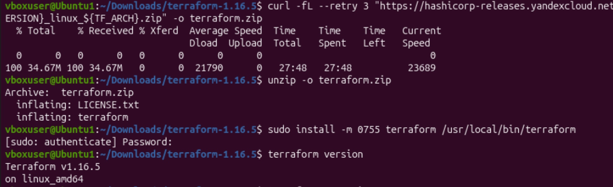

| Сейчас                    | Что исправить                                                  |
| ------------------------- | -------------------------------------------------------------- |
| resource "docker_image" { | Не указано локальное имя ресурса; далее код ожидает имя nginx  |
| "1nginx"                  | Имя ресурса начинается с цифры; используйте, например, "nginx" |
| random_string_FAKE        | Такого ресурса в активном коде нет; объявлен random_string     |
| .resulT                   | Ошибка в регистре; атрибут называется .result                  |


```
terraform {
  required_providers {
    docker = {
      source  = "kreuzwerker/docker"
    }
  }
  required_version = ">=1.12.0" /*Многострочный комментарий.
 Требуемая версия terraform */
}
provider "docker" {}

#однострочный комментарий

resource "random_password" "random_string" {
  length      = 16
  special     = false
  min_upper   = 1
  min_lower   = 1
  min_numeric = 1
}


resource "docker_image" "nginx"{
  name         = "nginx:latest"
  keep_locally = true
}

resource "docker_container" "nginx" {
  image = docker_image.nginx.image_id
  name  = "hello_world"

  ports {
    internal = 80
    external = 9090
  }
}

```

Ключ -auto-approve отключает запрос подтверждения перед применением плана Terraform. Опасность в том, что ошибочные изменения будут выполнены сразу: Terraform может не только создать ресурсы, но и удалить или пересоздать существующие. Это может привести к потере данных или остановке сервисов. Ключ не отключает проверки Terraform, но убирает последнюю возможность остановиться перед выполнением изменений.
Этот ключ полезен для автоматизации: например, в CI/CD-пайплайнах, скриптах развёртывания и при создании временных тестовых сред, где некому вручную вводить yes. При этом изменения должны проходить предварительные проверки и согласование.


Docker-образ `nginx:latest` не был удалён, потому что в предоставленном коде у ресурса `docker_image` установлен параметр **`keep_locally = true`**:

```hcl
resource "docker_image" "nginx" {
  name         = "nginx:latest"
  keep_locally = true
}
```

Этот параметр предписывает провайдеру сохранить образ в локальном хранилище Docker при выполнении `terraform destroy`. Поэтому контейнер удаляется, а образ остаётся. [library](https://library.tf/providers/kreuzwerker/docker/latest/docs/resources/image)

## Подтверждение из документации

В документации Docker-провайдера, в разделе `resource docker_image` → `Schema` → `Optional`, указано:

> `keep_locally` (Boolean) If true, then the Docker image won't be deleted on destroy operation. If this is false, it will delete the image from the docker local storage on destroy operation. [library](https://library.tf/providers/kreuzwerker/docker/latest/docs/resources/image)

«Если значение равно `true`, Docker-образ не будет удалён при операции уничтожения. Если значение равно `false`, образ будет удалён из локального хранилища Docker при операции уничтожения». [library](https://library.tf/providers/kreuzwerker/docker/latest/docs/resources/image)

