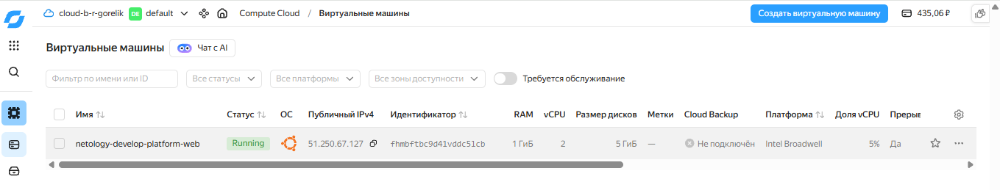
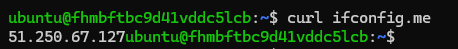
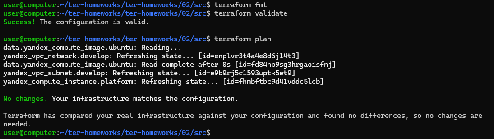
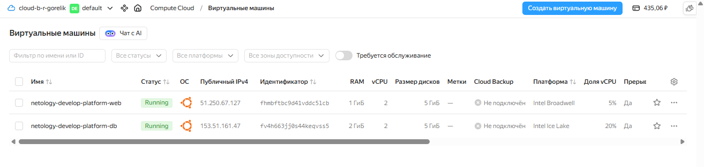
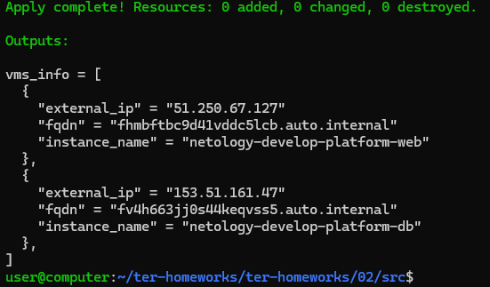
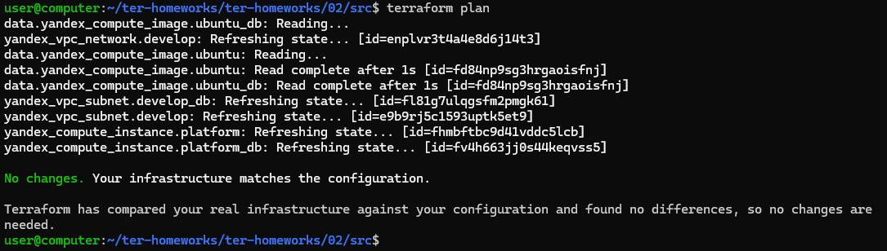

## ДЗ «Основы Terraform. Yandex Cloud» Борис Горелик

### Задание 1

В исходной конфигурации обнаружены ошибки в описании виртуальной машины:

В параметре platform_id указано некорректное значение standart-v4: допущена опечатка в слове standard, а сам идентификатор не соответствует выбранной поддерживаемой платформе. Значение заменено на standard-v1.

В параметре resources.cores указано одно ядро. Для платформы standard-v1 требуется минимум два vCPU, поэтому значение изменено с 1 на 2. Остальные параметры — 1 ГБ памяти и гарантированная доля vCPU 5% — совместимы с этой конфигурацией.

Это не ошибки синтаксиса HCL: структура блоков и запись выражений корректны. Это ошибки значений параметров — некорректный идентификатор платформы и недопустимая конфигурация ресурсов.

Параметр preemptible = true позволяет использовать более дешёвую прерываемую ВМ, которая подходит для временных учебных стендов, допускающих остановку. Параметр core_fraction = 5 снижает затраты за счёт небольшой гарантированной доли производительности vCPU. Совместное использование этих параметров помогает экономить бюджет при выполнении лабораторных работ, где не требуются непрерывная доступность и стабильно высокая вычислительная мощность.

## Задание 2

Хардкод-значения в источнике данных yandex_compute_image и ресурсе yandex_compute_instance заменены переменными с префиксом vm_web_. Переменные объявлены в variables.tf с явным указанием типов и значениями default, соответствующими прежним значениям в main.tf. Ссылки на образ и подсеть сохранены. После выполнения terraform plan изменений инфраструктуры не обнаружено.

## Задание 3

При создании второй ВМ в зоне ru-central1-b API Yandex Cloud вернул ошибку FailedPrecondition: Zone ru-central1-b is not available. Подсеть при этом была создана успешно. Из-за недоступности зоны ВМ и её подсеть размещены в ru-central1-d. Платформа второй ВМ изменена на standard-v3, поскольку standard-v1 в этой зоне не поддерживается. Параметры ресурсов сохранены: 2 vCPU, 2 ГБ RAM, гарантированная доля vCPU 20%.

## Задание 4

## Задание 5

В файле locals.tf создан один блок locals с локальными значениями vm_web_name и vm_db_name. Имена ВМ формируются интерполяцией переменных проекта, окружения, платформы и роли сервера. В ресурсах ВМ ссылки var.vm_web_name и var.vm_db_name заменены на local.vm_web_name и local.vm_db_name. Итоговые имена сохранены, поэтому после выполнения terraform apply изменений инфраструктуры не произошло.

## Задание 6

