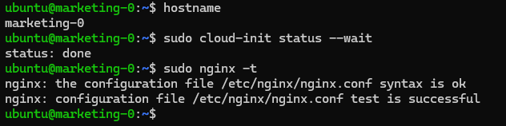
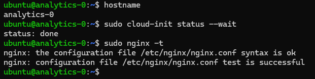
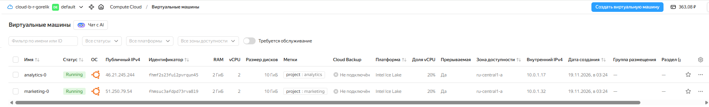
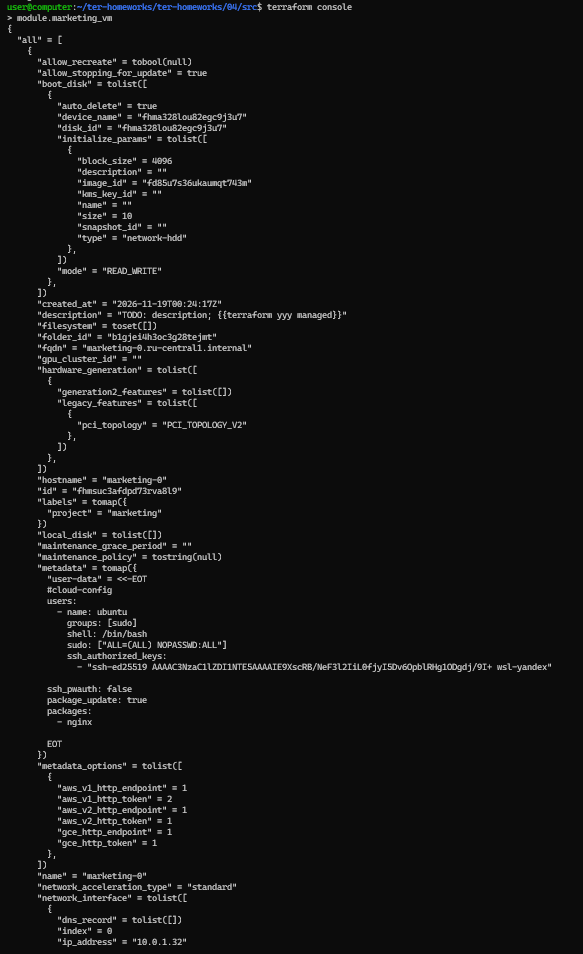
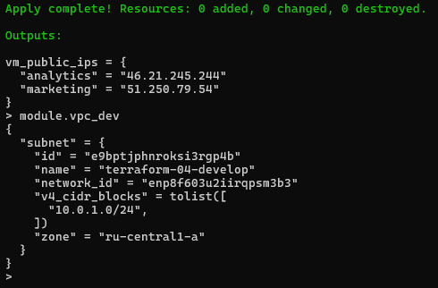
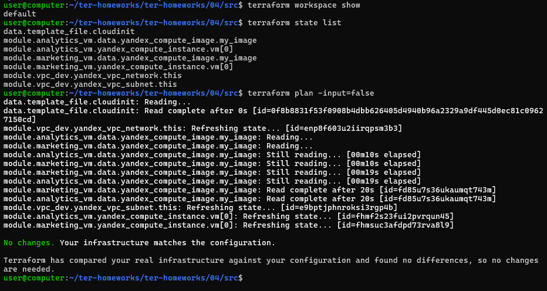
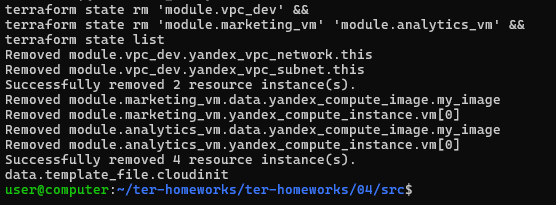
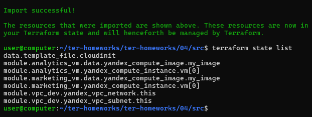
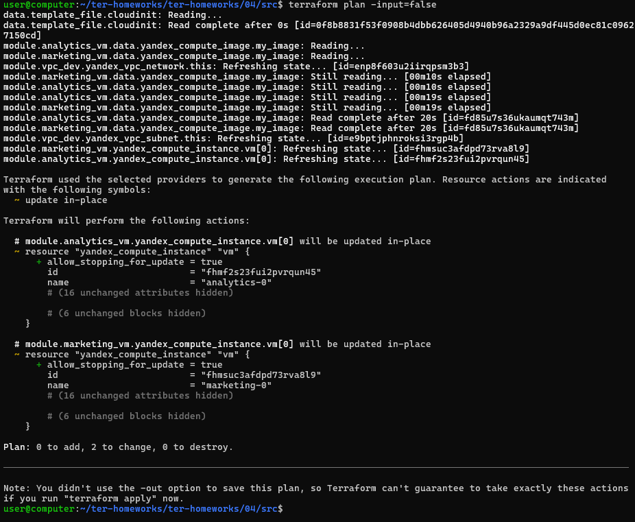

## ДЗ № 4. Продвинутые методы работы с Terraform

### Задание 1. Удалённый модуль и cloud-init

В [`src/main.tf`](src/main.tf) один удалённый модуль из демонстрации вызван дважды: `marketing_vm` и `analytics_vm`. Каждый вызов создаёт одну прерываемую ВМ в `ru-central1-a`. ВМ различаются именами и метками `project=marketing` и `project=analytics`; версия удалённого модуля закреплена по коммиту.

Публичный SSH-ключ считывается из файла (по умолчанию `~/.ssh/id_ed25519.pub`) и передаётся через `vars` в `data "template_file" "cloudinit"`. В [`src/cloud-init.yml`](src/cloud-init.yml) ключ становится элементом списка `ssh_authorized_keys` пользователя `ubuntu`. Тот же шаблон устанавливает `nginx` на обе ВМ через `packages`, а рендер передаётся в `metadata["user-data"]`. Приватный ключ в конфигурации не используется.

`yc compute instance list` показал обе ВМ в статусе `RUNNING`. Вход по SSH на `marketing-0` подтверждён приглашением `ubuntu@marketing-0:~$`. Успешный `sudo nginx -t` и скриншоты из облака в отчёт пока не приложены.






### Задание 2. Локальный модуль VPC

Локальный модуль [`src/vpc`](src/vpc/) создаёт ровно одну сеть и одну подсеть. Он принимает `network_name`, `zone` и `v4_cidr_blocks`, а через `output "subnet"` возвращает `id`, `network_id`, имя, зону и CIDR. Оба модуля ВМ получают ID сети, ID подсети и зону из `module.vpc_dev.subnet`.

Корневые объявления сети и подсети заменены вызовом `module.vpc_dev`. Два блока в [`src/moved.tf`](src/moved.tf) описывают перенос прежних адресов в модуль. При проверке с подменённым провайдером Terraform показал два переноса и `Plan: 0 to add, 0 to change, 0 to destroy`; исходные ID сети и подсети сохранились. Этот тест не заменяет проверку реального облачного состояния.

Документация модуля находится в [`src/vpc/README.md`](src/vpc/README.md). Команда её генерации из `04/src`:

```bash
terraform-docs markdown table --output-file README.md --output-mode inject ./vpc
```



### Задание 3. Операции с Terraform state

Подготовлен [список команд для резервного копирования, удаления записей и обратного импорта](state-import.md). Удаляются записи `module.vpc_dev`, `module.marketing_vm` и `module.analytics_vm`, а не сами ресурсы Yandex Cloud. Импорт выполняется в порядке: сеть, подсеть, `marketing-0`, `analytics-0`.

Проверка после импорта: `terraform state list` и `terraform plan -input=false`. Ожидается отсутствие значимых изменений инфраструктуры. Фактический итоговый план после импорта не приложен, поэтому результат этого этапа пока не подтверждён.





